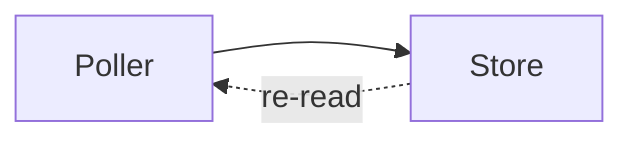

Author or edit a Hive Desktop agent workspace: a named, durable directory
where a CLI agent runs against a purpose-built MCP tool set, for work that has
no repository.

Hive Desktop is a desktop app that turns GitHub activity and webhook deliveries
into triaged feeds and automated coding-agent sessions. Its configuration is
plain text on this machine, meant to be edited directly:

- /Users/Z00HCXG/.config/hive/desktop/flows/<id>.yaml — flows: the graph that decides what reaches which feed and what fires an action.
- /Users/Z00HCXG/.config/hive/desktop/actions.yml — actions: what a feed item, a terminal session or window, or a flow node can trigger.
- /Users/Z00HCXG/.config/hive/desktop/settings.yaml — app settings: polling, updates, notifications, appearance, keyboard shortcuts.

Every workspace lives under /Users/Z00HCXG/.config/hive/desktop/workspaces:

    /Users/Z00HCXG/.config/hive/desktop/workspaces/mcps.yaml                      — your own MCP server library
    /Users/Z00HCXG/.config/hive/desktop/workspaces/skills.yml                     — your skill package library
    /Users/Z00HCXG/.config/hive/desktop/workspaces/.shared/skills/<slug>/SKILL.md — skills you author
    /Users/Z00HCXG/.config/hive/desktop/workspaces/<dir>/agent-workspace.yaml     — one workspace's manifest
    /Users/Z00HCXG/.config/hive/desktop/workspaces/<dir>/AGENTS.md                — the workspace's own instructions, hand-edited

`<dir>` is the workspace's directory name and its whole identity — there is no
separate id field, so create one by creating the directory. Opening a
workspace regenerates everything else under `<dir>` (`CLAUDE.md`, `.mcp.json`,
`.codex/config.toml`, `.claude/`, `.agents/`, an empty `docs/`) from the
manifest and `AGENTS.md`. None of that generated output is meant to be
hand-edited — it is silently replaced the next time the workspace opens. The
documents a chat's agent writes through the `hive-drive` MCP
tools are not here: they live in the workspace's Hive Drive space,
`workspaces/<dir>` under hive's context directory. Put
prose in `AGENTS.md`, not in the manifest: `agent-workspace.yaml` carries no
`system_prompt` field.

Rules for every file above:

- The schema is strict: an unknown key is a hard error, not a warning. Do not invent fields.
- The app watches these files and reloads on save — no restart, no build step.
- A file that fails to parse is rejected as a whole and the last good version stays live, so a mistake degrades to "nothing changed" rather than a broken app.

## agent-workspace.yaml schema

- `version` — must be `5`.
- `name` — display name shown on the workspace's card.
- `command` — the whole invocation, as a Go template rendered when a session starts. It is required, and it is the only thing that decides what runs. There is no `agent` key: Hive reads the label off the command's first word to pick the icon, the activity indicator and the resume probe, and a CLI it has never heard of is a normal workspace.

  Available fields: `.Dir` (the workspace directory), `.MCPConfig` (the generated `.mcp.json`, written for every workspace whatever the agent), `.SessionID` (a uuid Hive minted), `.Resume` (true when reattaching to a conversation), and `.Prompt` (an optional opening message for a schedule, the New chat dialog, an action, or a chat started with `chat_create`, `hive dt chat create` or an applet's `hive.startChat`). `shq` quotes a value for the shell: use it on every interpolated value.

  A workspace with `schedules:` or one used by a prompted launch needs a command that passes `.Prompt` through `shq`. Hive refuses a prompt-dropping or unquoted command because the detached chat would either sit idle or let prompt text become shell syntax. Every launch that carries a prompt checks this: the New chat dialog disables such a workspace when a prompt is set, and the other launches refuse with `invalid`. A config migration that rewrites `command` can drop the tail, so check a migrated workspace's command (`workspace_list` reports it) before you point a prompt at it. End the command with `{{ if .Prompt }}-- {{ .Prompt | shq }}{{ end }}`, which is what the shipped presets do.

  The line runs as `cd <workspace> && <your command>` under a login shell, so an env prefix or a pipeline works. Break it across several lines for readability; they are folded before rendering.

  Pin the session id (`--session-id {{ .SessionID }}`) or Hive cannot address the conversation later. Branch on `.Resume` or a reopened session relaunches fresh — Hive decides a command supports resume by rendering it both ways and checking that the output differs.

  A claude workspace usually wants:

  ```yaml
  command: >-
    claude --permission-mode acceptEdits
    --strict-mcp-config --mcp-config {{ .MCPConfig | shq }}
    {{ if .Resume }}--resume{{ else }}--session-id{{ end }} {{ .SessionID }}
    {{ if .Prompt }}-- {{ .Prompt | shq }}{{ end }}
  ```

  `--dangerously-skip-permissions` (and codex's `--dangerously-bypass-approvals-and-sandbox`) skips prompting entirely. Hive flags a command carrying one, but the flag is yours to add: reserve it for a workspace you already trust completely, remembering that every enabled MCP server is in reach.
- `mcps` — optional list of MCP server ids this workspace enables. Each id is either one of the shipped catalogue entries below or a key from your own mcps.yaml `servers:` map; an mcps.yaml entry can also replace a shipped entry of the same id.
- `skills` — optional list of **skill package** names this workspace enables, each a key from skills.yml's `packages:` map. Packages are the unit, never individual skills: `skills: [hive]` carries every `hive-*` skill this build ships, because that is what the seeded package's pattern selects. Naming a skill slug here (`hive-mcp`) enables nothing — it is read as a package that does not exist and reported when the workspace opens. Opening renders the selected skills into `.claude/skills/` and `.agents/skills/`. Hive removes only the skills it installed there, so a skill only this workspace needs can be written straight into `.claude/skills/<slug>/SKILL.md` (or `.agents/skills/` for an agent that reads that tree) and survives every open, unless an enabled package installs a skill of the same name.
- `schedules` - optional list of recurring chats this workspace launches on its own, on a cron schedule. See "schedules schema" below.

## schedules schema

Recurring chats this workspace launches on its own. Each entry in the
`schedules` list:

- `id` - required, `[a-z0-9-]+`, unique within this workspace.
- `name` - optional, shown in the UI and used to name the launched chat; defaults to `id`.
- `cron` - required. A 5-field cron expression, or one of `@hourly`, `@daily`, `@weekly`, `@monthly`, `@every 1h`. Evaluated in local time.
- `prompt` - required. A Go `text/template` string, rendered into the agent's opening message. See "Prompt template variables" below.
- `disabled` - optional; `true` skips this schedule. Omitted means enabled.
- `on_missed` - optional, `run` (default) or `skip`. `run` folds every occurrence Hive missed while it was closed into one catch-up launch; `skip` records a missed occurrence instead of launching.

Hive frames a scheduled chat before it starts: it tells the agent which
schedule and workspace started it, that nobody is watching, and how to end the
session when the task is done (a `curl` to Hive's loopback server with a token
the launch handed the process). The agent MUST end the session; a chat left
open blocks the schedule's next run. Write `prompt` as the task itself and
leave that framing to Hive.

An id is `[a-z0-9-]+` and must be unique in the workspace, so do not reuse one
for a different schedule. Changing a schedule's `cron` restarts its cursor, so
nothing back-fires: Hive only ever measures missed occurrences since the last
time this exact `cron` ran, never since the schedule was first created. An
edit to `schedules:` -- yours or the agent's -- takes effect the next time this
workspace opens; no restart needed. With the `hive-desktop` MCP server
declared in `mcps:`, `schedule_put`, `schedule_delete`, `schedule_list` and
`schedule_preview` make the same edit in place, one entry at a time, without
touching the rest of the file; a `schedule_put` on an existing id changes only
the fields it passes.

### Chats started by an agent or an applet

A chat started with `chat_create` (the `hive-chats` MCP server), `hive dt chat create` or
an applet's `hive.startChat` is not a scheduled chat. Hive passes the prompt as written
and does not tell the agent to end the session, so use it for a chat that keeps running,
such as an orchestrator. The same callers pin and unpin chats in the Code sidebar with
`chat_pin_put` and `chat_pin_delete`, `hive dt chat-pin`, or `hive.pinChat`.

To let a workspace's own agent start chats in other workspaces, add `hive-chats` to its
`mcps:`. Each started chat runs its own workspace's command and permission settings.

### Prompt template variables

`prompt` renders with:

- `{{ .Now }}` - the time the prompt is rendered.
- `{{ .ScheduledFor }}` - the occurrence this run honors.
- `{{ .LastRun }}` - the `ScheduledFor` of this schedule's previous launched run; unset on the first run. `date` renders it as empty text when unset, but write `{{ if .LastRun }}...{{ end }}` when you want different wording for the first run, as in the example below.
- `{{ .Reason }}` - why this run is happening: `due`, `catch_up`, or `manual` (a "Run now" from the UI).
- `{{ .Missed }}` - how many earlier occurrences in the same window were folded into this run.
- `{{ .Schedule.ID }}`, `{{ .Schedule.Name }}`, `{{ .Schedule.Cron }}` - this schedule's own fields.
- `{{ .Workspace.Dir }}`, `{{ .Workspace.Name }}` - the workspace running it.
- `{{ date "2006-01-02" .Now }}` - a helper that formats a time value with a Go reference-time layout.

A weekly summary that reads back how long it has been since the last run:

```yaml
schedules:
  - id: weekly-summary
    name: Weekly product summary
    cron: "0 9 * * 5"
    prompt: |
      Summarize product activity since {{ if .LastRun }}{{ date "2006-01-02" .LastRun }}{{ else }}last week{{ end }}.
      Check this workspace's MCP servers and write up what changed.
```

## skills.yml schema

The skill package library — which skills a workspace can enable as a unit.

- `version` — must be `1`.
- `packages` — a map of package name to definition. Each entry has an optional `title` and `description`, an `include` list (required, at least one pattern), and an optional `exclude` list.

  Patterns are globs over skill *names*, not file paths: `include: ["hive-*"]` selects every shipped skill, `exclude` then carves out. A pattern with no wildcard is an exact name, so selecting one skill needs no separate syntax. A package holds no copy of a skill, so one skill can belong to several packages and a newly authored skill joins every workspace whose enabled package already matches its name.

  Names come from two sources in one flat name-space: the skills this build ships (`hive-*`, rendered per install) and the ones authored at `.shared/skills/<name>/SKILL.md`. An authored file of the same name as a shipped skill wins.

## mcps.yaml schema

Your own MCP server library — the escape hatch beyond the shipped catalogue.

- `version` — must be `1`.
- `servers` — a map of id to server declaration. Each entry is one of:
  - a **stdio** server: `command` (required), `args`, `env`.
  - an **http** or **sse** server: `type: http` or `type: sse`, `url` (required), `headers`.

  `type` defaults to `stdio` when omitted. A stdio entry rejects `url`/`headers`; an http or sse entry rejects `command`/`args`/`env`.

## Shipped MCP catalogue

### Chrome DevTools — `chrome-devtools`

The `chrome-devtools` MCP server gives an agent DevTools' view of a real
Chrome: read network requests, console messages, and performance traces, run
Lighthouse-style audits, and inspect the live page. It is Google's own MCP
server (`chrome-devtools-mcp`), not a Hive-authored wrapper.

It is the inspection counterpart to `playwright`, not a replacement: enable
`playwright` to drive UI flows, `chrome-devtools` to debug what a page is
doing — network, console, and performance — while it runs. A web workspace
often wants both.

#### Launch

Hive launches it over stdio:

```
npx -y chrome-devtools-mcp@latest
```

`-y` skips npx's interactive install confirmation, which would otherwise
stall a non-interactive agent launch the first time this package version is
fetched on a machine. `@latest` is the documented invocation; Hive does not
vendor or pin a specific `chrome-devtools-mcp` version, so a workspace
enabling this entry gets whatever the registry resolves at launch time.

#### Stability

`stable`. The server is Google-maintained, past 1.0, and its launch command
is settled.

#### What it needs

Node.js 20.19 or newer and a current stable Chrome installed and reachable
from the workspace's environment. No credentials, and nothing
workspace-specific: this entry ships with no configuration in M1.

### Hive Chats — `hive-chats`

The `hive-chats` MCP server starts agent workspace chats and pins them to the
Code sidebar. It is how an orchestrator agent hands work to another workspace:
it starts a named chat with an opening prompt, and the user finds the chat in
Chats, or in the Code sidebar when it is pinned.

| Tool | What it does |
| --- | --- |
| `chat_list` | Every chat, or one workspace's, with `running` and `pinnedAt`. |
| `chat_create` | Start a chat: `workspace`, `name`, optional `prompt` and `pinToCode`. |
| `chat_pin_put` | Pin a chat to the Code sidebar. |
| `chat_pin_delete` | Unpin a chat. |

The same operations are `hive dt chat list`, `hive dt chat create`, and
`hive dt chat-pin put|delete`.

#### Authority

`chat_create` runs the target workspace's command, with that workspace's MCP
servers and permission settings. A workspace whose command bypasses
permissions starts an agent that acts without asking. Grant `hive-chats` only
to a workspace you trust to start others.

A started chat is not a scheduled chat: Hive passes the prompt as written and
does not tell the agent to end the session.

#### Launch

The server requires a bearer token
(ADR chat-control-is-served-on-a-token-guarded-mcp-server-whose-token-the-endpoint-file-carries).
The desktop mints the token on every start and writes it to the endpoint file
in the hive data directory, readable only by the user. `hive mcp serve` reads
it on every call, so a workspace's entry runs
`hive --data-dir <dir> mcp serve --toolset chats` over stdio.

The entry has no HTTP form. When the `hive` command does not report the same
version as the app, the catalogue reports a problem instead of an address.

#### What it needs

`http.enabled` in `settings.yaml` (on by default), and the hive CLI at the
app's version on the session PATH, or at `daemon.hive_path`.

### Hive Desktop — `hive-desktop`

The `hive-desktop` MCP server is this install itself. It is how a workspace's
agent observes and operates the running app — reading the inbox, feeds,
profiles and action catalog, forcing a source refresh, and dry-running a flow
— instead of reading `desktop-pipeline.db` or editing config files blind
(ADR mcp-replaces-the-agent-facing-http-api).

It is the only shipped entry that is not a third-party program: there is
nothing to install and nothing to fetch, because the server is already running
inside the app the agent was launched from.

#### Launch

Hive reaches it over Streamable HTTP on the loopback server that also hosts
the webhook listener:

```
http://127.0.0.1:<port>/mcp
```

The port is allocated at startup, so this entry carries **no URL in the
registry** — it is resolved when the catalogue is rendered and written into a
workspace's generated `.mcp.json` at that moment (`Descriptor.RuntimeURL`).
That is also why the catalogue reports a problem, rather than a URL, when the
loopback server is disabled: an entry that rendered an address nothing answers
would fail silently inside the agent's own `/mcp` output.

The server requires no token. It sits behind the loopback bind and runs no
command a caller writes: a source refresh runs only the command sources a flow
already declares, and session control stays on the HTTP adapter's
token-guarded terminal prefix (ADR terminal-transport, ADR
a-workspace-declares-its-own-authority).

#### Stability

`stable`. Each tool is declared once in the operation catalog, with a
noun-first name (`inbox_list`, `schedule_put`), and the same operation is a
`hive dt` command (`hive dt inbox list`).

#### What it needs

`http.enabled` in `settings.yaml`, which is on by default. Nothing else — no
Node, no network access, and no per-workspace configuration.

When the `hive` command reports the same version as the app, a workspace's
entry runs `hive --data-dir <dir> mcp serve` with this server's toolsets over
stdio instead of the HTTP address, so it holds no port.

### Hive Drive — `hive-drive`

The `hive-drive` MCP server is an agent's output surface. Its tools put
documents in front of the user, in the Drive tab of a chat or a Code
session, while the session keeps running. It is the difference
between describing a plan in terminal scrollback and handing the user one to
read (ADR hive-drive-is-one-document-tree-under-the-context-root-and-a-canvas-is-one-document-kind-in-it).

Like `hive-desktop`, the server is the running app itself: nothing to
install, nothing to fetch. It is a separate entry so a workspace can have the
drive without granting the app-control tool set, and the other way around.

#### Spaces and the caller argument

Hive Drive is one folder tree under hive's context directory, split into
spaces. A space is a repository (`owner/repo`), a Chats workspace
(`workspaces/<name>`), or the one `shared` space. Every tool works inside the
space of the caller, and every tool takes a `caller` that names the caller.
It is one of three things:

- In a Hive chat it is the `HIVE_AGENT_SESSION` environment variable, which
  Hive sets in the launched process. The space is the chat's workspace, so
  every chat of a workspace sees the same documents. A chat launched before
  the variable existed does not have it until it is relaunched.
- Anywhere else it is the absolute path of your working directory. Hive finds
  the hive session whose checkout holds it, and the space is that session's
  repository: the folder the checkout links as `.hive`. Every session of a
  repository sees the same documents, and nothing is written into the
  checkout itself.
- Outside a chat and a hive session it is the word `global`, and the space is
  `shared`. A directory inside no hive session is `not_found`, not global:
  pass `global` yourself. The shared space sits beside no chat or session and has
  no tabs, so `tab_open` and `tab_close` refuse it; the user reads it in the
  Drive page.

#### Paths and kinds

A path is relative to the space root, with forward slashes, no empty segment,
no segment that starts with a dot, and nothing that climbs out with `..`.
The empty path is the space root, which only `document_list` takes.

What a document is follows from its name:

- **markdown**, `.md`: GitHub-flavored markdown, optionally opening with
  YAML front matter. Raw HTML in the body is escaped, not rendered.
- **html**, `.html`: a page of its own, shown in a sandboxed frame. Inline
  styles and scripts run. Scripts, styles and fetches load only over `https`;
  images, fonts and media load over `https` or as a `data:` URL. Forms and
  frames do not work. A `#fragment` link scrolls the page; a relative link
  does nothing, so link to other documents from markdown.
- **file**: anything else in the folder. Hive lists it and leaves it alone,
  and `document_get` reads it when it is UTF-8 text.

Folders are created as needed when you write, so file a plan as
`plans/auth-rewrite.md` without making `plans/` first. Name documents by
artifact (`release-notes`, `perf-report`), not by conversation: they outlive
the chat or session that made them, and other agents and the user read the
same tree. List before you write over something you did not make.

#### Front matter

A markdown document may open with YAML front matter between two `---` lines.
`title` is the name the user sees in the tree; any other keys are yours.
`document_put` refuses front matter that does not parse, and front matter
that does not close within the first 8 KiB, rather than saving a document
Hive would show without its title. Hive does not add or change anything in a
markdown document's front matter.

#### Document tools

- `document_list`: a folder's entries, folders first. Each entry has a
  `kind` (`dir`, `markdown`, `html`, `file`), `path`, `name`,
  `title`, `size`, `modified`, and `front` for markdown. `detail`
  defaults to `children`, one level down; `tree` returns the whole subtree.
  The answer names the `space` and echoes the `detail` it used. A missing
  folder is `not_found`.
- `document_get`: one markdown or html document, or any other UTF-8 text
  file, its entry plus `body` exactly as stored. A binary file is refused.
- `document_put`: create or replace a whole `.md` or `.html` document,
  up to 2 MiB. Answers with the entry as stored.
- `document_move`: rename or move a document or a folder inside
  the space. The target must not exist, and a document keeps its extension.
  Answers with the entry at its new path.
- `document_delete`: delete a document or an empty folder, and
  answer with the path deleted. There is no recursive delete and no trash.

A write while a Drive tab is open behind another tab lights a dot on that tab.
With no Drive tab open, a write shows nothing until the user opens Drive, so
call `tab_open` when something is finished and worth reading now, not on every
write.

#### Tabs and layout

Drive, Diff, Tasks and terminals open as tabs in panels beside a chat or Code
session. A panel holds tabs, and a split joins two panels side by side or
stacked. You can do with the layout what the user can. Every call below is a
request to the app: the tab change applies only while the user is viewing this
chat or session, and there is no acknowledgment. The tmux side of `terminal`
is the exception: `tab_open` starts or finds the window and `tab_close` kills
it whether or not the session is on screen.

A tab reference names one tab, in a `tab` or `anchor` input:

- `drive`, `diff` or `tasks` name that view. A chat has only `drive`.
- `terminal` names a chat's one terminal.
- `applet:<id>` names an applet's tab. `tab_open` opens it if the applet's
  `applet.yaml` lists `surfaces.tab`, which runs its page, and `tab_close` ends
  it.
- Anything else is a tmux window of a Code session, by id (`@3`) or exact
  name. A Code session must name its window; `terminal` alone is refused.

The tools:

- `tab_open`: open the tab for a `view` (`drive`, `diff`, `tasks`, `terminal`
  or `applet:<id>`). `path`, for `drive`, is a document by its path in the
  space; it must exist, and a folder is refused. `placement` is `behind` (the default; behind
  a tab, with an unseen dot, never takes the screen), `beside` (a split to the
  right) or `below` (a split downward). `anchor` is the tab to place relative
  to; omit it for the tab in front of the focused panel. A tab that is already
  open stays where it is. The answer names the `view`, the resolved `path` and,
  for `terminal`, the `window` id.
- `tab_close`: close the tab for `drive`, `diff` or `tasks`. Documents are
  untouched. `terminal` needs `window` and kills that tmux window
  and what runs in it; only close a window you started. A chat's terminal is
  the chat, so it is refused.
- `tab_move`: move `tab`. `placement` `behind` puts it in the anchor's panel
  right after the anchor, or at the end of the focused panel with no anchor.
  `beside` and `below` split the anchor's panel (or the focused one) and move
  the tab into the new panel.
- `tab_focus`: bring `tab` forward and focus its panel. A window is also
  selected in tmux, by the app and only while the session is on screen.
- `panel_close`: close the panel that holds `tab`. Its tabs join the
  neighbouring panel, and the last panel stays.
- `split_resize`: give the side that holds `tab` a `share` of its nearest
  split, from 0.2 to 0.8.
- `split_turn`: turn the nearest split of `tab` between side by side and
  stacked.
- `layout_get`: read the layout the app last reported: `panels` with their
  `tabs` (each spelled the way the tools take it, with `kind`, the window
  `name` for a Code session, and `shown` for the panel's front tab),
  `focusedPanel`, `splits` (`axis` `row` is side by side, `column` is
  stacked; `first` and `second` are panel or split ids), and `onScreen`. When
  `known` is `false` the app has not reported this layout yet, for instance
  just after it started or when the session has never been open in Code; act
  without it.

Call `layout_get` first when you are not sure what is open. Layout changes may
land after the call returns, so read again before you build on one.

`tab_focus` and `tab_close` on a terminal are the two that take something from
the user: the first takes the screen, the second ends a running process. Use
`tab_focus` when the user asked to see something, not to show off a result;
for a result use `tab_open`, which leaves the focus where it is. Close only a
window you started.

A `terminal` opens detached, so it never takes the keyboard or the screen. A
new one is a shell in the session's checkout with nothing running in it: the
tool takes no command, so run your own work yourself and open a terminal for
the user to type in. The session must be running; start it in Code first. Two
inputs apply to `tab_open` with `terminal` only, and either with another view
is refused:

- `name`: the name of the new window.
- `window`: an existing window of the session, by tmux id (`@3`) or exact
  window name. It is placed instead of starting one, so it excludes `name`. A
  window the session does not have is `not_found`.

#### Diff reviews

When the user asks you to review a Code session's changes, write the review
with these tools instead of pasting it into the terminal. The Diff view draws
each comment under the lines it is about. The user dismisses the ones they
disagree with, can reply to one with context, and Send delivers the rest to the
session's agent with their own comments. The user's replies to a comment reach
the session's agent inside that comment, in order; they do not come back
through `diff_review_get`. A review is about the branch
against its base, the Branch comparison, which is what a pull request shows.

- `diff_review_put`: store your review: a `summary` and `comments`. In a hive
  session it reviews your own session; in a chat, name one in `sessionId`, by
  id or name from `session_list`. Each comment has a `path`, `text`, a
  `severity` (`issue`, `suggestion` by default, or `note`), and either
  `startLine` and `endLine` or `kind` `file` for the whole file. Lines count
  as the branch has them; with `startSide` `deletions` they count as the base
  had them, for a removed line. Hive quotes the rows itself. Set `agent` to
  `claude`, `codex` or `pi` so the view draws your mark. A second review from
  the same `author` replaces the first, so send the whole review each time.
- `diff_review_get`: the reviews still waiting. A comment the user dismissed or
  sent is gone from it.
- `diff_review_clear`: withdraw your review, or every review of the session.

Every comment must name a file in the branch diff, and a lines comment must
name rows the diff shows: changed lines or the context around them. Read the
diff with `git diff $(git merge-base HEAD origin/<base>)` in the checkout to
get the numbers right. A refused review lists every comment to fix and stores
nothing. Keep each comment to one actionable point and put the overview in
`summary`. When the review is stored, open the `diff` tab with `tab_open`.

#### Writing a Mermaid diagram

Put a standalone `mermaid` fence in a markdown document:

````markdown

````

Hive renders diagrams with Mermaid's strict security mode. Diagram scripts,
HTML labels and interactive links stay disabled. A diagram that does not parse
shows an error in place without breaking the surrounding markdown. Theme
changes redraw the diagram with the current theme colours.

Each diagram sits in a pan-and-zoom viewport. Drag to pan, use the controls to
zoom or fit the whole diagram, or hold Control/Command while scrolling to zoom
around the pointer.

Copy and save preserve the source fence, so Markdown viewers with Mermaid
support can render the exported diagram too.

#### Launch

Hive reaches it over Streamable HTTP on the loopback server that also hosts
the webhook listener:

```text
http://127.0.0.1:<port>/mcp/drive
```

The port is allocated at startup, so this entry carries **no URL in the
registry**: the live address is resolved when the catalogue is rendered
(`Descriptor.RuntimeURL`), and the catalogue reports a problem instead when
the loopback server is disabled. The first allocated port is written to
`settings.yaml` as `http.port`, so the address stays the same across
restarts.

A workspace that lists `hive-drive` gets this server in its generated MCP
configuration. When the `hive` command (`daemon.hive_path`, else the
login-shell PATH) reports the same version as the app, the entry is a stdio
server, `hive --data-dir <dir> mcp serve --toolset drive,layout`. It finds
the app through its endpoint file on every call and fills `caller` itself, so
the entry holds no port and the agent passes no caller. Otherwise the entry is
the HTTP address above. Any other agent, such as the one a hive session runs,
gets the same entry when the user presses Add in Settings ▸ MCP servers; Hive
edits an agent's own configuration only then.

The HTTP server requires no token. It sits behind the loopback bind, runs no
command a caller writes, and writes only inside the caller's space under
hive's context directory.

### Playwright — `playwright`

The `playwright` MCP server gives an agent a real, controllable browser:
navigate, click, fill forms, take screenshots, and read page content and the
accessibility tree. It is Microsoft's own MCP server for Playwright
(`@playwright/mcp`), not a Hive-authored wrapper.

#### Launch

Hive launches it over stdio:

```
npx -y @playwright/mcp@latest
```

`-y` skips npx's interactive install confirmation, which would otherwise
stall a non-interactive agent launch the first time this package version is
fetched on a machine. `@latest` is the documented invocation; Hive does not
vendor or pin a specific `@playwright/mcp` version, so a workspace enabling
this entry gets whatever the registry resolves at launch time.

#### Stability

`stable`. The server and its launch command are settled; this entry's shape
in the catalogue may still change if a configurable variant ships later
(see the catalogue's Migration Notes).

#### What it needs

Node.js and a Playwright browser install reachable from the workspace's
environment — the same prerequisites `npx @playwright/mcp` has anywhere else.
Nothing workspace-specific: this entry ships with no configuration in M1.

## Worked example

A complete, valid `agent-workspace.yaml` naming shipped catalogue entries
(`hive-desktop`, `playwright`), an `mcps.yaml` entry (`home-assistant`), and
the seeded `hive` skill package. `hive-desktop` is this install itself —
declaring it is what lets a session read the inbox and dry-run a flow rather
than guessing at the app's state:

```yaml
version: 5
name: Home Assistant
# The whole invocation, as a Go template. Available fields: .Dir, .MCPConfig,
# .SessionID and .Resume; shq quotes a value for the shell.
command: >-
  claude --permission-mode acceptEdits
  --strict-mcp-config --mcp-config {{ .MCPConfig | shq }}
  {{ if .Resume }}--resume{{ else }}--session-id{{ end }} {{ .SessionID }}
mcps:
  - hive-desktop
  - playwright
  - home-assistant
skills:
  - hive
```

The `mcps.yaml` it references:

```yaml
version: 1
servers:
  home-assistant:
    title: Home Assistant
    type: http
    url: http://homeassistant.local:8123/mcp
    headers:
      Authorization: "Bearer op://vault/item/token"
  local-tool:
    command: npx
    args: ["-y", "@example/mcp"]
    env:
      TOKEN: "op://vault/item/token"
```

And the `skills.yml` defining the `hive` package it enables:

```yaml
version: 1
packages:
  hive:
    title: Hive
    description: Configure Hive Desktop itself — flows, actions, settings, webhooks.
    include:
      - "hive-*"
  infra:
    title: Infrastructure
    include: ["terraform-*", "k8s-*", "runbook"]
    exclude: ["terraform-experimental"]
```

---

What I want:

<describe it here>
